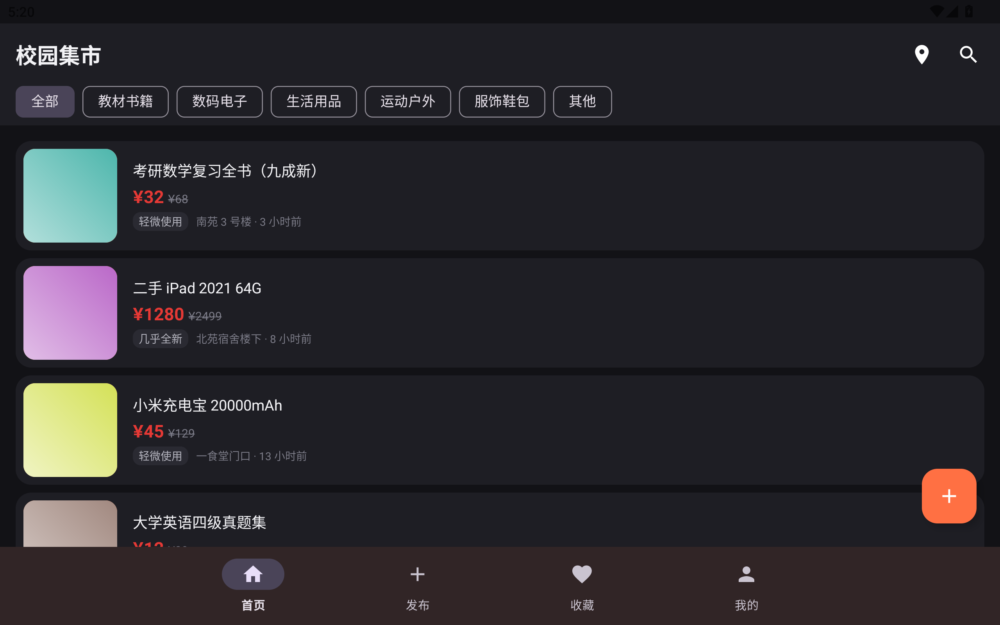
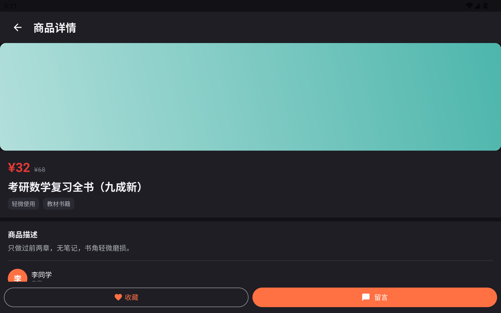
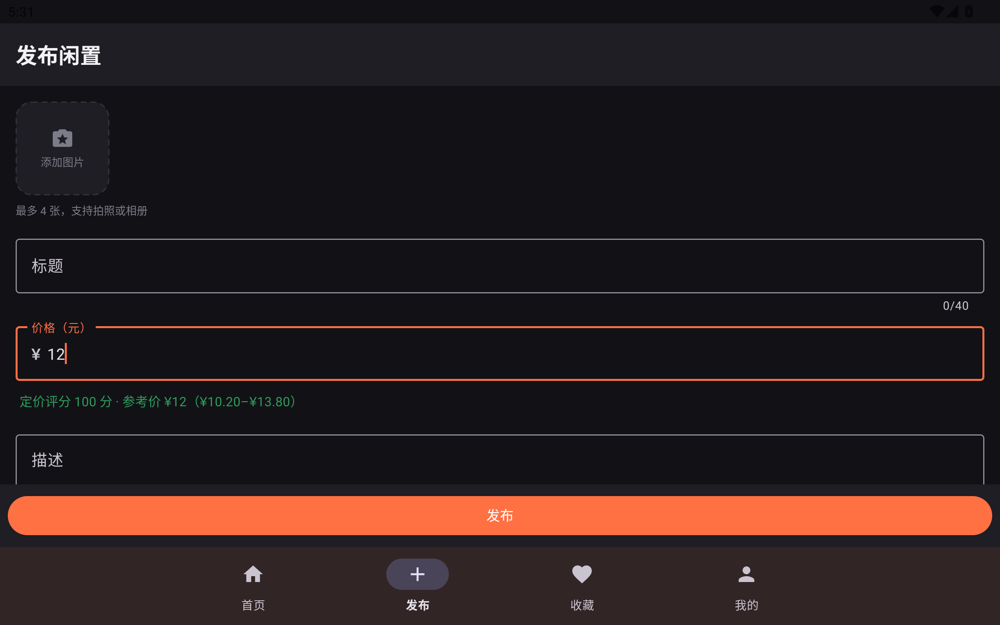
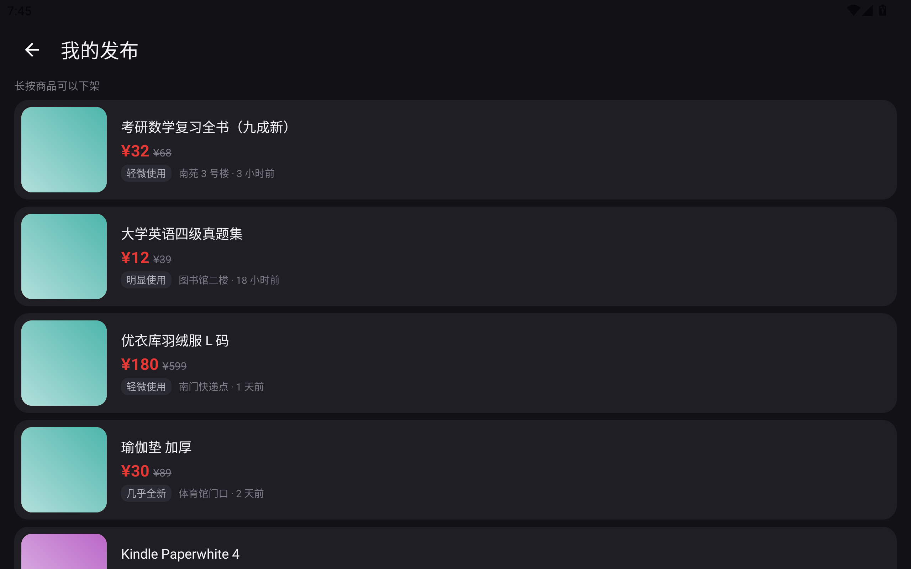

# CSM · 校园集市

> 2024 级 Android 课程设计 · 主 App（2 学分）+ 伴生模块（1 学分）
> 学号：202405100221　姓名：郭祉谦
> 选题：**B1 校园二手交易（无支付）** + 伴生模块 **P1 桌面小组件**

## 这个仓库是什么

同一份项目的两个可评分成果，在同一个仓库里分目录/分支管理：

| 成果 | 课程 | 目录 | 说明 |
| --- | --- | --- | --- |
| 主 App | Android 移动终端应用开发技术（2 学分） | `app/` | 校园二手交易平台，追求技术深度 |
| 伴生模块 | 移动互联网应用开发实战（1 学分） | `companion/`（第 8 次提交起） | 桌面小组件，读取主 App 数据，独立可演示 |

## 已定的两个必做功能 + 一个自选功能

按「同题防抄袭」要求，本项目在 B1 之外定下的组合是：

1. **必做 ①：收藏** —— 详情页一键收藏/取消，收藏落 Room（`favorites` 表 + `MIGRATION_1_2`），
   「收藏」页按收藏时间倒序展示、可点进详情，空态引导去逛首页；详情页按钮文案与图标随状态切换。
2. **必做 ②：留言** —— 商品详情「留言」进入会话页；服务端 `messages` 表与四个接口
   （列表/发送/未读数/已读），发送失败保留草稿，未读数供小组件与通知使用。
3. **自选：桌面小组件（伴生模块 P1）** —— 4×2 桌面组件展示在售/收藏/未读三个数字与最新商品，
   经只读 `ContentProvider` 读主 App 数据，支持手动刷新与深链跳转，未登录/空库/未安装均有降级。

在此基础上还额外实现了三个加分项（超出必做要求，答辩时可讲技术深度）：

- **智能定价助手**：自研估价算法（原价 × 同类目折扣率中位数 × 成色系数 × 时长折旧），发布时给出建议价区间、
  0~100 定价评分与「捡漏」标记；
- **图片处理流水线**：多图 → 采样解码 → EXIF 旋正 → 长边 1280px / 质量 82% 重编码（天然抹掉 GPS）→ 带进度上传；
- **附近好物**：校园地点坐标表 + Haversine 距离排序；拒绝定位权限时降级为最新发布排序并提示，App 仍可用。

基础功能全部保留：商品列表、详情、发布、搜索筛选、我的发布。

## 技术栈

- Kotlin 2.0.21 + AndroidX，`minSdk 24 / targetSdk 35`
- Jetpack：Navigation、ViewModel、Lifecycle、Room（第 3 次提交接入）、WorkManager（第 12 次）
- Material 3（`Theme.Material3.DayNight`，支持深色模式）
- 网络：Retrofit + OkHttp（第 6 次提交接入），后端为仓库内自建的 Ktor + SQLite 服务（第 5 次提交已就绪）
- 图片：CameraX + 自研压缩/EXIF 清洗；异步统一用 Coroutines + Flow
- 构建：AGP 8.9.1 + Gradle 8.11.1，JDK 17 字节码

## 本地构建

```bash
# 1. 指定 SDK 位置（本地文件，不入库）
echo "sdk.dir=C:\\Apps\\sdk" > local.properties

# 2. 编译
./gradlew assembleDebug

# 3. 跑单元测试
./gradlew testDebugUnitTest
```

> 本机环境提示 1：`JAVA_HOME` 需指向 JDK 17+（本项目在 `D:\java\jdk`，JDK 21）后再执行 Gradle。
>
> 本机环境提示 2：如果 Windows 用户名或工程路径里含中文，Gradle 测试任务会报
> `ClassNotFoundException: GradleWorkerMain`。此时把 Gradle 用户目录改到纯英文路径即可：
> `set GRADLE_USER_HOME=D:\AndroidGradle`（Android Studio 在
> `Settings → Build Tools → Gradle → Gradle user home` 改同一项）。
> 详见 [docs/07-测试与问题记录.md](docs/07-测试与问题记录.md) 问题 7。

## 本地跑服务端（自建 Ktor + SQLite）

`server/` 是随仓库提交的参考后端，商品数据、分页筛选、智能定价基准都在这里实现，
App 端第 6 次提交起接入它。

```bash
# 默认监听 8080；本机 8080 被占用时用环境变量换端口
CSM_PORT=18080 ./gradlew :server:run
```

```bash
# 冒烟测试（Windows 下请把 JSON 写成 UTF-8 文件再用 @file，见 docs/07 问题 8）
curl http://127.0.0.1:18080/health
curl "http://127.0.0.1:18080/api/products?page=1&size=5&category=BOOK&sort=priceAsc"
curl "http://127.0.0.1:18080/api/price-stats?category=DIGITAL"
```

- 数据库文件 `server/data/csm.db` 首次启动自动创建并灌 14 条样例数据，已加入 `.gitignore`；
- 想重置样例数据，删掉该文件重启即可；
- 接口约定与错误码见 [docs/04-接口设计.md](docs/04-接口设计.md) 4.9 节。


## 文档

| 文档 | 内容 |
| --- | --- |
| [docs/01-选题与需求分析.md](docs/01-选题与需求分析.md) | 选题背景、用户与场景、竞品与差异 |
| [docs/02-功能清单.md](docs/02-功能清单.md) | 功能清单 + 对照课程最低复杂度标准逐条说明 |
| [docs/03-系统设计与数据模型.md](docs/03-系统设计与数据模型.md) | 分层架构、页面结构、ER 模型、模块划分 |
| [docs/04-接口设计.md](docs/04-接口设计.md) | 后端 REST 接口、请求/响应示例、错误码 |
| [docs/05-开发计划与提交记录.md](docs/05-开发计划与提交记录.md) | 15 次提交的计划与实际记录、里程碑对应 |
| [docs/06-个性化功能设计.md](docs/06-个性化功能设计.md) | 智能定价算法、图片流水线、附近好物的设计与公式 |
| [docs/07-测试与问题记录.md](docs/07-测试与问题记录.md) | 测试用例、真机/模拟器验证记录、踩坑与修复 |
| [docs/08-伴生模块设计.md](docs/08-伴生模块设计.md) | P1 桌面小组件的交互、数据来源与刷新策略 |

## 提交规范

提交信息统一用 Conventional Commits：

- `feat:` 新功能　`fix:` 修复　`refactor:` 重构　`docs:` 文档
- `chore:` 构建/依赖　`test:` 测试　`style:` 格式

例如：`feat(home): 完成商品列表与分类筛选`。每个大功能拆成「UI → 逻辑 → 联调」多次提交，
详见 [docs/05-开发计划与提交记录.md](docs/05-开发计划与提交记录.md)。
## 模块结构

| 目录 | 说明 |
| --- | --- |
| `app/` | 主 App（2 学分）：列表/详情/发布/搜索/收藏/留言/我的发布/我的 |
| `companion/` | 伴生模块（1 学分）P1：桌面小组件，独立模块，经 `content://com.csm.market.widget/summary` 读主 App 数据 |
| `server/` | 自建轻量后端（Ktor + SQLite + 本地文件存储），提供商品/定价/上传/留言接口 |
| `docs/` | 需求、功能清单、系统设计、接口、测试记录、伴生模块设计 |

## 演示顺序（3 分钟录屏建议）

1. 启动 `server`（`CSM_PORT=18080`），浏览器打开 `/health` 确认服务在线；
2. 模拟器里打开校园集市：首页三态 → 分类筛选 → 搜索「iPad」→ 排序；
3. 详情页收藏、留言；返回「收藏」页确认同步；
4. 发布一条商品：拍照/选图（自动压缩 + 去 GPS）→ 看智能定价提示 → 提交 → 首页出现；
5. 「我的」→「我发布的」→ 长按一条已发布商品下架，确认首页同步消失；
6. 回到桌面长按添加「校园集市 · 我的摊位」小组件，确认在售/收藏/未读数字与最新商品；
7. 点小组件跳回 App；断网后重进首页看离线横幅与缓存降级。

## 界面截图

以下截图拍摄于 MuMu 模拟器（Android 12）真实运行环境，数据来自本仓库 `server/` 模块。

| 首页（列表 + 分类筛选） | 商品详情 | 发布页（智能定价） | 我的发布（长按下架） |
| --- | --- | --- | --- |
|  |  |  |  |